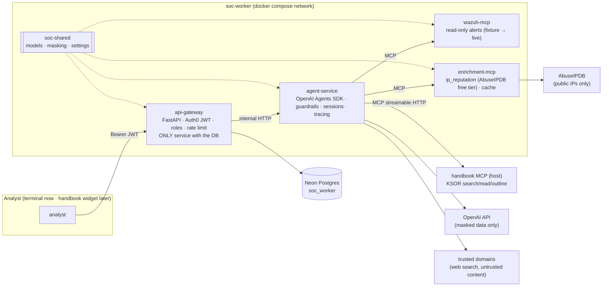
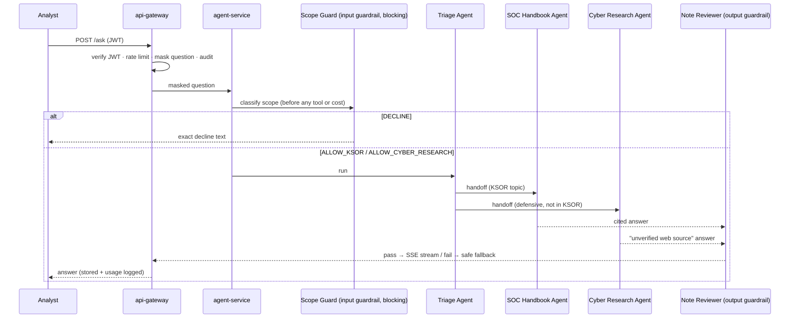
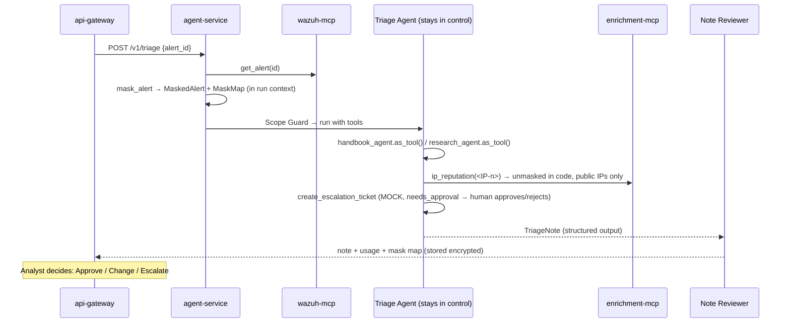

# Architecture (target state, plan v2 §4–5)

Status: feature 01 built `soc-shared` only. Everything else below is planned (features 02–10).

## Services

## /ask flow (handoff pattern)

## /triage flow (agents-as-tools pattern)

